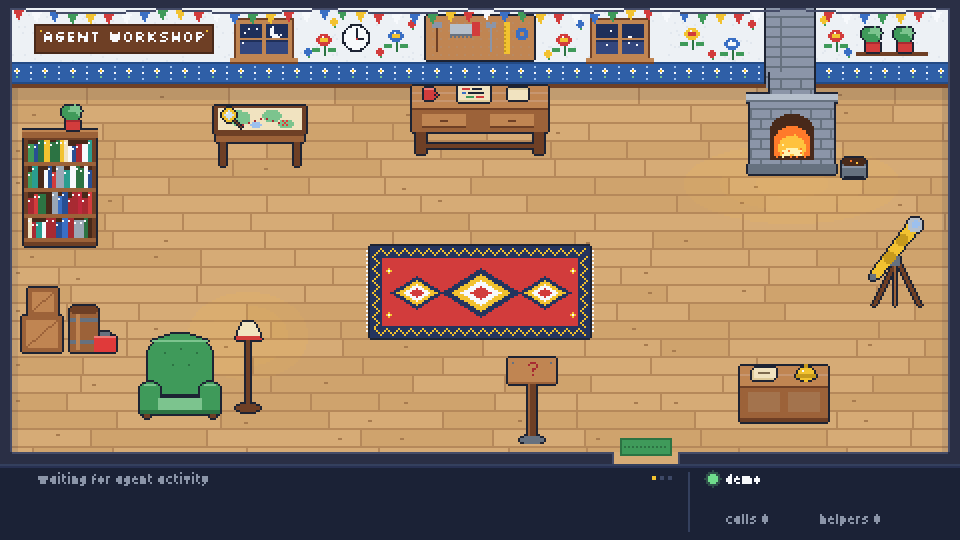
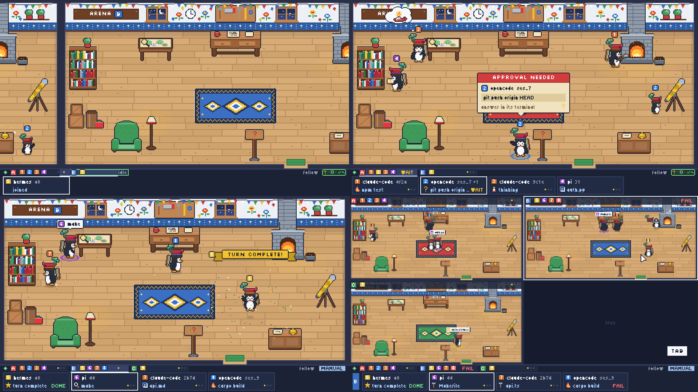

# Agent Workshop

[Polski](README.pl.md)

Watch AI coding agents work as penguins in a pixel-art workshop.



Agent activity (tool calls, subagents, permission prompts, errors) becomes a small event stream. A local program, the **bridge**, passes it to the **app**, where a penguin walks between workshop stations and uses a different tool for each kind of work. Claude Code, OpenCode, Pi and Hermes Agent are supported.

This project is mostly for fun. It is a way to watch agents work, and it is not a monitoring tool.

Agent Workshop is an independent project. It is not made, endorsed or sponsored by the makers of Claude Code, OpenCode, Pi or Hermes Agent. Those names belong to their owners and are used only to say which agents it works with.

## Pick your path

| I want to... | Go to |
|---|---|
| See the app with no setup | [Try the app](#try-the-app) |
| Watch my own agent work | [Watch a real agent](#watch-a-real-agent) |
| Build from source or change the code | [Build and develop](#build-and-develop) |

## Try the app

1. Download the app for your system from the [latest release](https://github.com/pgorazda/agent-workshop/releases/latest) (`AgentWorkshop-<version>-<system>`) and unpack it.
2. Start it. The apps are not signed: on macOS right-click the app and choose Open, on Windows choose "More info" and then "Run anyway" in SmartScreen.
3. Press **D** and pick a scene. Each scene is a made-up session that plays with no bridge and no agent.

## Watch a real agent

You need the app (above), the bridge, and a small forwarder for your agent.

**1. Start the bridge.** Download `AgentWorkshopBridge-<version>-<system>` from the same release, unpack it and run:

```bash
./agent-workshop-bridge serve        # listens on http://127.0.0.1:8787
```

On macOS, run `xattr -d com.apple.quarantine agent-workshop-bridge` once after you unpack it. The bridge needs no Node and no other runtime. It listens on `127.0.0.1` only and stores nothing.

**2. Start the app.** It connects to the bridge by itself. To let the app start the bridge for you, run it with `--start-bridge` (the bridge program must be next to the app or on your `PATH`).

**3. Connect your agent.** Pick one in [docs/adapters.md](docs/adapters.md): Claude Code (hooks), OpenCode (plugin), Pi (extension, or a JSON pipe) or Hermes Agent (hook script). Each takes one file copy or one config merge.

The agent can run on another machine, for example over SSH: see [Agent on another machine](docs/adapters.md#agent-on-another-machine).

No agent at hand? Replay a recorded session, with the app already running:

```bash
./agent-workshop-bridge replay schema/examples/claude-code-transcript.jsonl --speed 4
```

**What leaves your machine?** Nothing. The bridge listens on `127.0.0.1` only. Clients receive no message text, tool output or file contents. Targets (a command or a file name) can still be in the stream: start the bridge with `--redact-targets` to drop them. Details are in [docs/adapters.md](docs/adapters.md).

## Build and develop

Install [mise](https://mise.jdx.dev), then:

```bash
mise install          # Node and Rust at the pinned versions
mise run bridge       # run the bridge from the source
mise run replay       # send the example session to it
mise run app          # run the app (downloads the pinned Godot editor the first time)
mise run demo         # the app on a made-up scene, no bridge
mise run check        # all checks of the CI on your machine
```

`mise tasks` lists the rest. Without mise, the plain commands, the tests, recording and releases are in [CONTRIBUTING.md](CONTRIBUTING.md).

## How it works

```
agent (hooks, plugin, extension)  -->  bridge  -->  app
                  HTTP in: POST /event, POST /hook/<framework>      WebSocket out: /ws
```

An adapter turns each agent's native events into one framework-neutral event format ([docs/event-schema.md](docs/event-schema.md)). The app picks a workshop station from the event's category, never from a tool name. When one room is full, more rooms (arenas) open and a camera moves between them ([docs/arenas.md](docs/arenas.md)). Why it is built this way is in [docs/design.md](docs/design.md).



## Status

| Part | State |
|---|---|
| Event schema v1, the bridge (Rust, one binary per system), and the adapters for Claude Code, OpenCode, Pi and Hermes | Done and tested |
| OpenCode plugin, Pi extension, Hermes hook script | Written from the published docs and types, tested with fixtures. **Not yet run inside a real OpenCode, Pi or Hermes** |
| The app (Godot): live sessions, arenas, sound, seven demo scenes | Done for desktop. Only the Windows x86_64 app was run on real hardware. Not done: signing, tablets and phones |

Known limits of the adapters are in [docs/adapters.md](docs/adapters.md#known-limits).

## The look and the sound

The room is drawn in a look of its own, at 480×270 pixels, inspired by the penguin's cap (the rogatywka from Kraków) and by Polish folk art: the painted flowers of Zalipie, folk painting from Lipnica Murowana, Bolesławiec pottery and kilim rugs. The app plays four original tunes in the manner of Polish folk dances (krakowiak, kujawiak, oberek and góralski) and five event sounds. All sound starts off. Press **M** to turn it on.

## Contributing and security

See [CONTRIBUTING.md](CONTRIBUTING.md) to work on the code, [SECURITY.md](SECURITY.md) to report a security problem privately, and the [code of conduct](CODE_OF_CONDUCT.md).

## Layout

```
schema/      the event schema and example sessions (made up)
bridge/      the bridge in Rust: schema check, adapters, server, CLI, tests
adapters/    the forwarders that run inside or beside each agent, and their tests
godot/       the app: project, scenes, tools and tests (godot/art/ holds the art)
docs/        user and contributor documents
```

## License

- **Code:** MIT. See [LICENSE](LICENSE).
- **Art:** all rights reserved. This covers the drawing and sound code in `godot/art/`, the images and sounds in it, the images in `docs/images/`, and images, video or sound made with them. See [LICENSE-ASSETS](LICENSE-ASSETS).

The fonts Tiny5 and Silkscreen are under the SIL Open Font License 1.1.
