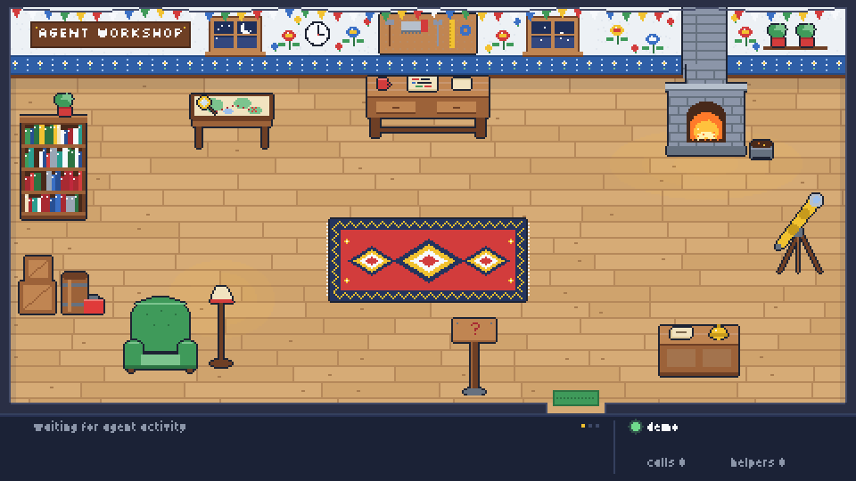
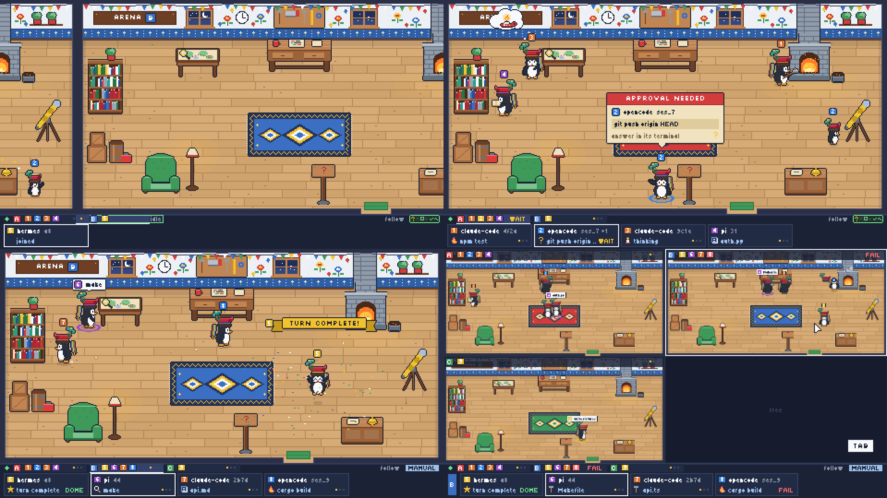

# Agent Workshop

> To jest tłumaczenie pliku [README.md](README.md). Jeśli wersje się różnią, obowiązuje wersja angielska.

Obserwuj, jak agenci programistyczni AI pracują jako pingwiny w pikselartowym warsztacie.



Aktywność agenta (wywołania narzędzi, subagenci, prośby o zgodę, błędy) jest zamieniana na mały strumień zdarzeń, niezależny od frameworka. Lokalny most (bridge) wysyła ten strumień do klienta Godot. Tam pingwin chodzi między stanowiskami warsztatu i przy każdym rodzaju pracy używa innego narzędzia. Claude Code, OpenCode, Pi i Hermes Agent działają przez małe adaptery.

Ten projekt powstał głównie dla zabawy. To sposób, by oglądać pracę agentów, a nie narzędzie do monitoringu. Wygląd i muzyka pochodzą z polskiej sztuki ludowej i tańców. Zobacz [Wygląd i dźwięk](#wygląd-i-dźwięk).

```
Claude Code hooks / OpenCode plugin / Pi extension or JSON stream / Hermes shell hooks / transcript replay
        |
   adapter (maps native events and tool names to the canonical schema)
        |
   bridge  --  POST /event, POST /hook/claude-code   (HTTP in)
        |      WS /ws                                (WebSocket out)
        v
   Godot client (godot/): one penguin per framework + session + agent, drawn in 2D pixel art
```

Gdy jeden pokój się zapełni, obok otwierają się kolejne pokoje (areny). Na ekranie jest jedna arena naraz, a kamera przesuwa się między nimi.



## Stan

| Część | Stan |
|---|---|
| Schemat zdarzeń v1 (`schema/`) | Gotowe |
| Bridge, adaptery dla Claude Code, OpenCode, Pi i Hermes, odtwarzanie transkryptów (`bridge/`) | Gotowe. To program w Ruście, który buduje się do jednego pliku wykonywalnego dla każdego systemu i nie potrzebuje Node. Pokryty 104 testami w Ruście (testy jednostkowe oraz prawdziwy plik z prawdziwymi klientami HTTP i WebSocket) i 3 testami skryptów adapterów z prawdziwym plikiem. Zastępuje pierwszą, węzłową wersję (ADR 0013), której wyniki zgadzają się z nim na kilkuset tysiącach danych testowych |
| Wtyczka OpenCode, rozszerzenie Pi, skrypt hooka Hermes (`adapters/`) | Napisane na podstawie opublikowanych definicji typów, dokumentacji i kodu źródłowego, sprawdzone na danych testowych. **Jeszcze nie uruchomione w prawdziwym OpenCode, Pi ani Hermes** |
| Klient Godot (`godot/`) | **Gotowy dla komputerów stacjonarnych: fazy G-0 do G-9 z [planu](docs/godot-client-plan.md).** Odtwarza sesję na żywo z bridge'a, z arenami, interfejsem i dźwiękiem, oraz siedem wymyślonych scen bez bridge'a. `godot/tools/record.mjs` nagrywa każdą scenę jako klip. `node godot/tools/export.mjs --platform all` buduje niepodpisane aplikacje dla Windows, Linuksa i macOS, a workflow wydań je publikuje (zobacz [`docs/releasing.md`](docs/releasing.md)). Na prawdziwym sprzęcie uruchomiono tylko aplikację dla Windows x86_64. **Niegotowe:** podpisywanie, tablety i telefony (odłożone) oraz pomiar na słabym laptopie referencyjnym. Zobacz [`godot/README.md`](godot/README.md) |
| Klient przeglądarkowy (`web/`) | **Niezbudowany.** ADR 0008 zastąpił go klientem Godot. [Jego plan](docs/browser-client-plan.md), [plan widoku 2D](docs/2d-view-plan.md), [plan aren](docs/2d-arenas-plan.md) i [plan trybu demo](docs/demo-mode-plan.md) zostają jako specyfikacja wyglądu i zasad |

Plany wspominają o rekordach decyzji architektonicznych (ADR) po numerze, na przykład ADR 0003. ADR-y są przechowywane poza tym repozytorium.

## Szybki start

### 1. Uruchom bridge

Bridge to jeden program, `agent-workshop-bridge`, bez Node ani innego środowiska uruchomieniowego. Pobierz archiwum bridge'a dla swojego systemu z najnowszego wydania (`AgentWorkshopBridge-<wersja>-<system>`), rozpakuj je i uruchom:

```bash
./agent-workshop-bridge serve        # http://127.0.0.1:8787, WebSocket path /ws
```

Bridge nie jest podpisany. W macOS po rozpakowaniu uruchom raz `xattr -d com.apple.quarantine agent-workshop-bridge`. Windows może pokazać SmartScreen („Więcej informacji", potem „Uruchom mimo to").

Aby zbudować go samodzielnie, potrzebujesz Rusta (stabilny toolchain):

```bash
cd bridge
cargo run --release -- serve         # to samo, ze źródeł (plik to bridge/target/release/agent-workshop-bridge)
```

Opcje: `--port` (domyślnie 8787, `0` wybiera wolny port), `--host` (domyślnie `127.0.0.1`), `--redact-targets`. Zmienne `ARENA_PORT`, `ARENA_HOST` i `ARENA_REDACT_TARGETS` robią to samo.

Aplikacja Godot może uruchomić bridge za Ciebie: uruchom ją z `--start-bridge` (albo ustaw `start=true` w jej pliku ustawień, zobacz `godot/README.md`). Robi to tylko wtedy, gdy żaden bridge nie odpowiada na lokalnym adresie, używa programu obok aplikacji lub w `PATH` (albo ścieżki, którą podasz) i zatrzymuje go przy zamknięciu.

Bridge nasłuchuje tylko na `127.0.0.1`. Zdarzenia mogą zawierać polecenia i nazwy plików. Uruchom bridge z `--redact-targets` (lub `ARENA_REDACT_TARGETS=1`), aby usunąć cele i tekst błędów, zanim opuszczą bridge.

Klient Godot czyta strumień (zobacz „3. Uruchom klienta Godot"). Aby zobaczyć, co wysyła bridge, możesz też połączyć dowolnego klienta WebSocket z `ws://127.0.0.1:8787/ws`.

### 2. Podaj mu zdarzenia

Wybierz agenta, którego używasz. To, co opuszcza każdego agenta, jest różne:

- **Wtyczka OpenCode i rozszerzenie Pi** wysyłają tylko kilka pól (nazwy narzędzi, cele, wyniki). Nigdy nie wysyłają tekstu wiadomości, wyniku narzędzi ani zawartości plików.
- **Hooki Claude Code i skrypt Hermes** wysyłają do bridge'a na `127.0.0.1` cały ładunek hooka agenta, razem z wynikiem narzędzia. Bridge zachowuje tylko kilka pól i rozsyła wyłącznie je. Nic nie jest zapisywane. Użyj `--redact-targets`, aby usunąć także cele i tekst błędów.

Niezależnie od wyboru strumień, który dostają klienci, nie zawiera tekstu wiadomości, wyniku narzędzi ani zawartości plików.

Odtwórz nagrany transkrypt Claude Code (czas zachowany, `--speed 0` oznacza brak opóźnień):

```bash
agent-workshop-bridge replay schema/examples/claude-code-transcript.jsonl --speed 4
# from the source: cd bridge && cargo run --release -- replay ../schema/examples/claude-code-transcript.jsonl --speed 4
# your own sessions: ~/.claude/projects/<project>/<session>.jsonl
```

**Claude Code** (na żywo): dołącz hooki z [`adapters/claude-code/settings.example.json`](adapters/claude-code/settings.example.json) do swojego `~/.claude/settings.json` (lub do `.claude/settings.json` projektu). Każdy hook wysyła swój ładunek do bridge'a przez `curl`, z limitem 1 sekundy i `|| true`. Dzięki temu wyłączony bridge nigdy nie blokuje agenta.

**OpenCode** (na żywo): skopiuj [`adapters/opencode/arena.js`](adapters/opencode/arena.js) do `.opencode/plugins/arena.js` w swoim projekcie albo do `~/.config/opencode/plugins/` dla wszystkich projektów. Wtyczka używa hooka `event`, więc błędy narzędzi, prośby o zgodę i subagenci (sesje potomne) są zgłaszani dokładnie.

**Pi** (na żywo, w każdym trybie): skopiuj [`adapters/pi/arena.ts`](adapters/pi/arena.ts) do `~/.pi/agent/extensions/arena.ts` albo wypróbuj go jednorazowo przez `pi -e ./adapters/pi/arena.ts`.

**Pi** (bez instalacji, tryb JSON): przepuść strumień zdarzeń Pi przez CLI bridge'a. `--tee` zachowuje widoczne wyjście Pi.

```bash
pi --mode json "your prompt" | agent-workshop-bridge ingest pi --tee
```

**Hermes Agent** (na żywo): Hermes może uruchamiać polecenia powłoki przy swoich zdarzeniach cyklu życia, z ładunkiem podobnym do Claude Code. Skopiuj [`adapters/hermes/arena-hook.sh`](adapters/hermes/arena-hook.sh) do `~/.hermes/hooks/arena-hook.sh` (zostaw go jako wykonywalny) i dołącz blok `hooks:` z [`adapters/hermes/config.example.yaml`](adapters/hermes/config.example.yaml) do `~/.hermes/config.yaml`. Hermes pyta o zgodę przy pierwszym spotkaniu każdego hooka. Dla uruchomienia nieinteraktywnego użyj `--accept-hooks` (lub ustaw `HERMES_ACCEPT_HOOKS=1`). Hermes uruchamia hooki synchronicznie i bez powłoki. Dlatego przekaźnik jest skryptem, który kończy się kodem 0 w ciągu sekundy, cokolwiek się stanie. Obejmuje wywołania narzędzi i błędy, prośby o zgodę (drogowskaz), subagentów (pingwiny pomocnicy) oraz początek i koniec tury.

Wtyczka OpenCode, rozszerzenie Pi i skrypt Hermes domyślnie wysyłają dane na `http://127.0.0.1:8787`. Ustaw `ARENA_BRIDGE_HTTP`, aby to zmienić. Tak jak hooki Claude Code szybko kończą się limitem czasu i nigdy nie blokują agenta.

### 3. Uruchom klienta Godot

Potrzebujesz edytora Godot w przypiętej wersji (plik `godot/GODOT_VERSION`). Ustaw `GODOT` na swój edytor albo pozwól, by `node godot/tools/get-godot.mjs` go pobrał (ten skrypt wymaga Node 20 lub nowszego). Szczegóły są w `godot/README.md`. Do sesji na żywo potrzebujesz też bridge'a (krok 1).

```bash
cd bridge && cargo run --release -- serve                                           # the bridge (or the downloaded binary: agent-workshop-bridge serve)
cd godot && "$GODOT" --path .                                                       # the client (import the project once: "$GODOT" --headless --path . --import)
cd bridge && cargo run --release -- replay ../schema/examples/claude-code-transcript.jsonl --speed 4   # events for the client
cd godot && "$GODOT" --path . -- --demo=multi                                       # a made-up scene, no bridge (also session, arenas, many, follow, ten, tour)
```

Klient pokazuje jeden pokój. Każdy agent, który wyśle zdarzenie, dostaje pingwina. Gdy agentów jest więcej, niż mieści jeden pokój, otwierają się kolejne pokoje (areny), a kamera przesuwa się między nimi. Najpierw uruchom klienta, potem odtwarzanie: bridge nie przechowuje historii. Klawisze, opcje i dźwięk opisuje `godot/README.md`. Sceny (`--demo=<nazwa>` lub klawisz D w aplikacji):

| Scena | Co odtwarza |
|---|---|
| `session` | Jedna sesja Claude Code |
| `multi` | Sześciu agentów naraz w jednym pokoju |
| `arenas` | Dziewięciu agentów w trzech arenach, z kamerą między nimi |
| `many` | Dziewięć aren na trzech stronach po cztery |
| `ten` | Czterdzieści aren na dziesięciu stronach |
| `follow` | Przełącznik, który wybiera, co porusza kamerę, i jej tempo |
| `tour` | Wycieczka po jednej arenie: zatrzymuje się przy każdym zdarzeniu i każdym stanowisku, a dymek wyjaśnia, co widać |

Aby nagrać scenę jako klip 1920×1080 albo zapisać klatki (tak powstają obrazy w `docs/images/`), potrzebujesz okna i `ffmpeg`:

```bash
cd godot && node tools/record.mjs --scene arenas      # out/arenas.mp4
cd godot && node tools/record.mjs --scene multi --stills 19.5 --no-switch    # out/still-multi-19.5.png
```

Aby dostać aplikację, która działa bez edytora (niepodpisana), pobierz ją ze strony wydań albo zbuduj:

```bash
cd godot && node tools/export.mjs --platform windows     # out/export/windows/AgentWorkshop.exe
# także: windows-arm64, linux, linux-arm64, macos (uniwersalna: Intel i Apple silicon), all
```

Pierwsze uruchomienie pobiera szablony eksportu (około 1,3 GB). Aplikacja przyjmuje te same opcje co edytor, po `--`.

### 4. Uruchom testy

```bash
cd bridge && cargo test               # the bridge: unit tests and tests with the real binary (also checks godot/test/fixtures)
node --test 'adapters/test/*.test.mjs'             # the OpenCode plugin, the Pi extension and the Hermes script against the real bridge (Node 22 or later)
cd godot && node tools/run-gut.mjs    # GUT tests, headless
cd godot && node --test               # Node tests: bridge link, license split, tools
cd godot && node tools/check.mjs      # GDScript check, warnings count as errors
```

Polecenia z `godot/` wymagają Node 20 lub nowszego, `GODOT` oraz toolchainu Rusta: testy, które uruchamiają bridge, najpierw budują go przez `cargo build` (albo ustaw `ARENA_BRIDGE_BIN` na plik wykonywalny).

## Schemat zdarzeń

`schema/event.schema.json` jest kontraktem między adapterami a klientem. Klient wybiera stanowiska tylko po `category`, nigdy po nazwach narzędzi:

| `category` | Stanowisko | Przykładowe narzędzia Claude Code |
|---|---|---|
| `read` | Regał z książkami | Read |
| `search` | Stół z mapą | Grep, Glob |
| `write` | Stół warsztatowy | Edit, Write |
| `exec` | Kuźnia | Bash |
| `web` | Teleskop | WebSearch, WebFetch |
| `delegate` | Biurko pomocnika (pojawia się pingwin pomocnik) | Task |
| `think` | Fotel do myślenia | TodoWrite |
| `ask_permission` | Drogowskaz | AskUserQuestion |
| `other` lub nieznana | Drobne prace | Narzędzia MCP, wszystko bez przypisania |

Ponadto: `tool_end` z `ok: false` powoduje, że pingwin się przewraca, `waiting_permission` wysyła go do drogowskazu, a `done` zaczyna świętowanie. Nieznane typy zdarzeń są przyjmowane i pokazywane jako zwykła praca.

## Dodawanie frameworka agenta

1. Napisz adapter w `bridge/src/adapters/`, który zamienia natywne zdarzenia frameworka na zdarzenia schematu v1. Użyj `category_for()` z `bridge/src/categories.rs` i `describe_target()` z `bridge/src/targets.rs`. W razie potrzeby dodaj do `categories.rs` nadpisania nazw narzędzi dla frameworka. `opencode.rs`, `pi.rs` i `hermes.rs` to krótkie, kompletne przykłady.
2. Zarejestruj go w `Adapters::map` i `Adapters::knows` w `bridge/src/adapters/mod.rs`. To daje mu trasę `POST /hook/<framework>`. Albo uruchom go obok agenta i wysyłaj (`POST`) zdarzenia kanoniczne na `/event`.
3. Dostarcz mały przekaźnik dla agenta (konfigurację hooków, wtyczkę lub rozszerzenie), który wysyła tylko pola potrzebne adapterowi, i umieść go w `adapters/<framework>/`.
4. Nadaj frameworkowi kolor sznura w reżyserze klienta. Kolory są wymienione w [planie klienta przeglądarkowego](docs/browser-client-plan.md).

Logika klienta się nie zmienia. Aby zgłosić aktywność subagenta tak, by dotarła do pingwina pomocnika, wyślij `subagent_start` z `id`, a potem użyj tego samego `id` jako `agent` w zdarzeniach subagenta (OpenCode tak robi).

## Wygląd i dźwięk

Pokój jest narysowany we własnym stylu, w rozdzielczości 480×270 pikseli. Inspiracją są czapka pingwina, rogatywka krakowska, oraz polska sztuka ludowa: malowane kwiaty z Zalipia, malarstwo ludowe z Lipnicy Murowanej, ceramika bolesławiecka i dywany kilimowe. Obrazy są plikami PNG, a kod, który je rysuje, jest w `godot/art/image_src/`. To nie jest MIT: zobacz [Licencja](#licencja). Czcionki pikselowe to Tiny5 i Silkscreen (SIL OFL 1.1).

Klient gra cztery oryginalne melodie w duchu polskich tańców ludowych (krakowiak, kujawiak, oberek i góralski) oraz pięć dźwięków zdarzeń (brzdęk młotka, dzwonek na biurku, plaśnięcie, dzwonek i fanfara). To pliki WAV, które `godot/tools/render-sound.mjs` renderuje z `godot/art/sound_src/sound.js`. Cały dźwięk jest domyślnie wyłączony.

## Układ

```
schema/          event.schema.json and example sessions for Claude Code, OpenCode, Pi and Hermes (synthetic, built from the documented formats)
bridge/          the bridge in Rust: schema validation, categories, adapters (Claude Code, OpenCode, Pi, Hermes), server, CLI, tests
adapters/        forwarders that run inside or beside each agent: Claude Code hooks, OpenCode plugin, Pi extension, Hermes hook script (and adapters/test/, their tests)
godot/           the Godot client: project, bridge link, scenes, tools and tests (GUT is kept in godot/addons/gut/, MIT)
godot/art/       the Godot client's art: drawing code, rendered images and sounds (all rights reserved, see LICENSE-ASSETS)
godot/demo/      the seven made-up scenes (JSON timelines)
docs/            the plan of the Godot client, and the plans of the browser client, its demo mode, its 2D view and its arenas (the rules stay the specification)
docs/images/     preview images made with the Godot client (all rights reserved, see LICENSE-ASSETS)
```

## Znane ograniczenia

- Ładunki hooków Claude Code nie wskazują, który subagent wykonał wywołanie. Dlatego praca subagenta pojawia się jako pingwin pomocnik, który wygląda na zajętego, a nie jako prawdziwe wywołania tego subagenta. OpenCode i Hermes zgłaszają sesje subagentów, więc ich subagenci pokazują swoją prawdziwą pracę.
- Adaptery OpenCode, Pi i Hermes opierają się na opublikowanych definicjach typów (`@opencode-ai/sdk` 1.19.5), dokumentacji (`@mariozechner/pi-coding-agent` 0.73.1) i kodzie źródłowym (`hermes-agent` 0.19.0) oraz są sprawdzone na syntetycznych danych testowych. Żaden nie został jeszcze uruchomiony z działającym agentem, a nazwy pól mogą się zmienić w nowszych wersjach.
- Hermes: ładunek hooka zawiera całe wyniki narzędzi, więc bridge przyjmuje do 10 MB na jedno wysłanie i przekazuje dalej tylko kilka pól. Prośby o zgodę nie niosą identyfikatora sesji i są przypisywane do sesji widzianej ostatnio, co może być błędne, gdy działa naraz kilka sesji Hermes. Hermes wysyła wywołania narzędzi subagenta z identyfikatorem sesji potomnej. Ustalono to z kodu źródłowego i nie potwierdzono jeszcze na żywo. `pre_llm_call` nie jest używany, bo niesie całą rozmowę. „Myślenie" pochodzi z pierwszego wywołania API każdej tury.
- Zdarzenie OpenCode `permission.updated` (przyjmowane także jako `permission.asked`) jest jedynym używanym sygnałem zgody. Pi nie ma wbudowanych próśb o zgodę, więc Pi nigdy nie pokazuje drogowskazu.
- Pi nie ma wbudowanych subagentów. Narzędzie przypisane do kategorii `delegate` (na przykład o nazwie `subagent`) tworzy pingwiny pomocniki.
- Błąd narzędzia z hooków jest wykrywany heurystycznie (`is_error`, `interrupted` lub pole `error`). Odtwarzanie transkryptów używa `is_error` i jest dokładne.

## Licencja

- **Kod:** MIT. Zobacz [LICENSE](LICENSE).
- **Grafika i dźwięk:** wszystkie prawa zastrzeżone. Dotyczy to kodu rysującego i kodu dźwięku w `godot/art/` (oraz później w `web/src/view2d/art/`), znajdujących się tam obrazów i dźwięków, obrazów w `docs/images/` oraz obrazów, wideo i dźwięku z nich zrobionych. Zobacz [LICENSE-ASSETS](LICENSE-ASSETS).

Czcionki Tiny5 i Silkscreen pochodzą z npm i są na licencji SIL Open Font License 1.1.
