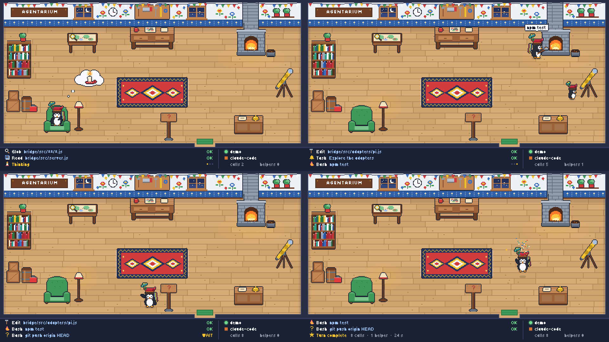
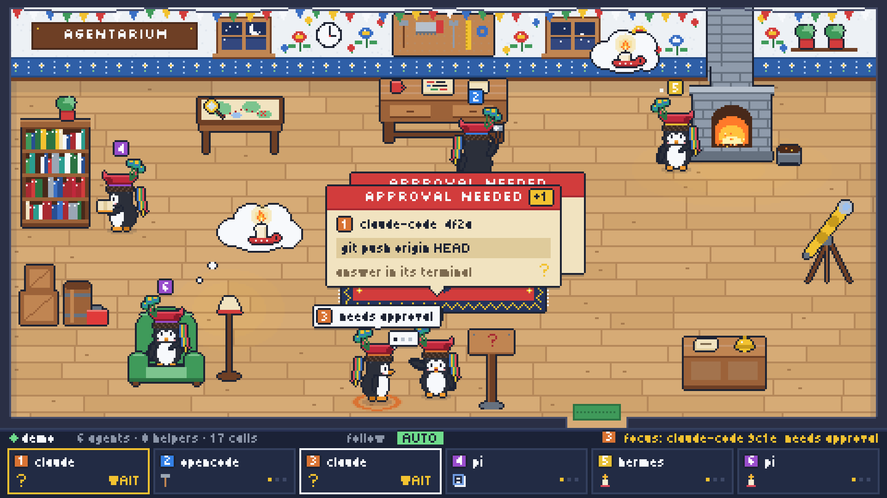

# Plan: the 2D view of the browser client

> **Note (phase G-10):** the Godot client builds this plan (see [the Godot client plan](godot-client-plan.md)). The rules in this plan stay the specification. The browser client is not built: ADR 0008 replaced it. The JavaScript mockup that is named below was removed; it is in the git history.

**State: a plan, nothing built yet.** The decisions are ADR 0003 (the view, proposed) and ADR 0004 (its look, accepted). It builds on the browser client of ADR 0002 and [its plan](browser-client-plan.md).

## Goal

`http://127.0.0.1:8787/` shows the workshop as a 2D pixel-art game: one room seen from above at an angle, with every penguin and station on screen. It reads the events through the client's director and actor; the view only draws.

Not in scope: a 3D view, changes to the schema or the adapters, and bridge changes beyond those the client plan already makes.



## What already exists

| Piece | Where it is now | What to do with it |
|---|---|---|
| The drawing code (see below) | The art code of the JavaScript mockup (removed, see the git history), about 680 lines | Now in `godot/art/` (see the Godot client plan) |
| Event parsing, the bridge client, the clock, the director, the actor, demo mode, the shared trace | The browser client plan (not built yet) | Use as they are |
| The station table | The browser client plan, `stations.js` | Project it from above |

The mockup's drawing code includes:

* a pixel sprite builder: ellipses, outlines, mirroring, rotation, pixel text;
* the penguin and its cap, in three directions and about twenty poses;
* the nine props and the room;
* dust, sparks, smoke, confetti and banners;
* the activity log.

## Design

### Layout

```
web/src/view2d/
  view2d.js         start-up and the frame: what to draw, in depth order, and when
  projection.js     floor position (x, z) to screen (x, y); facing to sprite direction
  log2d.js          the activity log's model (tested in Node)
  sound2d.js        which event plays which sound, and the sound state: tune, event sounds, all on or off
  art/              the look and the sound: all rights reserved, see LICENSE-ASSETS
    pixels.js       the sprite buffer and pixel text
    penguin2d.js    penguin sprites, cached per pose, direction, size and cord colour
    props2d.js      the room and the nine props, drawn once
    effects2d.js    dust, sparks, smoke, confetti, banners, tags, the thought cloud, the approval notice
    log2d-art.js    the drawing of the activity log, the cards and the bar
    sound.js        the four tunes and the event sounds, made by code with Web Audio
    sound-ui.js     the sound switch and its menu
```

The drawing and sound code lives only in `art/`, which is not MIT (see LICENSE-ASSETS). The other files may call it but do not contain it. The Godot client splits its code this way (`godot/art/`).

### Choices

1. **The page draws in 2D.** `main.js` starts the 2D view. It loads no WebGL library.
2. **A pixel grid.** The view draws at 480×270, then scales by the largest whole number that fits the window, with nearest-neighbour scaling. Any leftover space is filled with the log's background colour.
3. **The room from the station table.** One projection maps the floor to the screen: screen x = 240 + 28·x and screen y = 138 − 11·z, with x and z in metres. These are the mockup's values and still need tuning. The room therefore follows the station table. Props and penguins are drawn in order of screen y. If a stand point looks wrong from above, a small 2D-only offset per station fixes it.
4. **Penguins from the actor.** Each frame the view reads each penguin's position, facing and pose; the actor does not know how it is drawn. The facing picks the front, back or side sprite, mirrored for the left. The pose and the station kind pick the picture:

   | Where | What the penguin does |
   |---|---|
   | Bookshelf | reads a book |
   | Map table | points at the map |
   | Workbench | hammers, seen from behind |
   | Forge | shovels coal |
   | Telescope | looks through it |
   | Helper desk | rings the bell |
   | Thinking chair | sits under a thought cloud with a candle that burns down |
   | Sign post | waves under the approval notice |
   | After a failed call or at the end of a turn | flops or celebrates |

   The candle loses a pixel every few seconds of thinking and stops at a stub, so a long spell shows as a short candle. Each new spell of thinking starts with a new candle.
5. **Art drawn by code.** Sprites are drawn at start-up and cached as canvases, so there are no image files.
6. **The activity log.** It is built from the same events the director receives: `tool_start`, `tool_end`, `waiting_permission`, `thinking`, `done`, `subagent_*`. A small model keeps the last lines and their state (running, OK, FAIL, WAIT), and Node can test it. Long targets are shortened to fit.
7. **No camera inside a room.** The whole room is on screen. With several arenas ([the arenas plan](2d-arenas-plan.md)), a camera slides between rooms, never inside one, and Tab turns their overview on and off. With one arena, Tab does nothing.
8. **Fonts.** Tiny5 and Silkscreen come from `@fontsource`, installed at exact versions and served locally. Text is cut to whole pixels.
9. **Determinism.** Effects use the simulation clock and the seeded random numbers, so a test or demo run looks the same every time.
10. **The look's rules.** ADR 0004 lists what the view does not use; a test enforces it (see Testing).

## Several agents

Every agent works in the same room. The Godot client plays a scripted afternoon of six agents: `--demo=multi`, or record it with `node godot/tools/record.mjs --scene multi`.



1. **A number for each agent.** The cap cord shows the framework, so two sessions of the same framework look alike. Each agent therefore gets a number when it first appears, and keeps it while it is present. A chip with the number, in the cord colour, floats above the penguin and starts its card. A helper wears its parent's number, and the parent's card counts its helpers ("+1").
2. **One focus, with a switch (decided).** The focused agent gets a ring on the floor and a label saying what it is doing; the others show only their chip. A switch in the bar's top line, and the key F, sets how the focus moves:
   * **auto:** the focus follows the newest event, held for at least 1.5 s so it does not flicker. A failure, a request for approval or a finished turn takes it at once.
   * **click:** the focus moves only when you click a penguin or its card. New events do not move it; a card still blinks while its agent waits for approval.

   AUTO is the default (decided on 2026-11-11); `?follow=click` (or `?follow=manual`) sets the other mode from the URL. With several arenas the click mode is called MANUAL ([the arenas plan](2d-arenas-plan.md)).
3. **Extra spots, in the 2D view only (decided).** The station table and the actor keep one stand point per station. The 2D view gives most stations two or three spots of its own; the armchair, the telescope and the helper desk keep one. It puts an arriving penguin on the first free spot and draws its walk there. When every spot is taken, the penguin waits in line beside the station, with a "…" bubble, until one is free. Its card still shows the tool as running, because the agent is running it.
4. **Thinking.** The armchair seats one penguin. Any other penguin that is thinking does so where it stands, under a small cloud with its own candle.
5. **Approvals.** The notice names the agent (chip, framework, session id) above the command. When several agents wait at once, their notices stack at the sign post, oldest in front, with a "+N" counter, and their cards blink gold.
6. **The bar.** There is one card per agent:
   * up to five agents: number, framework, session id, an icon, the target and the status;
   * six to twelve agents (twelve is the director's limit on penguins): compact cards with the number, a short name, the icon and the status.

   The top line shows the connection, the counts, who has just joined, the focus switch and what the focused agent is doing.
7. **A finished turn** shows a ribbon with the agent's number, confetti and DONE on its card, while the others keep working.
8. **A failure shakes the room** for 0.4 s, as with one agent, whichever agent failed and whatever the focus mode; the card bar stays still. There is at most one shake a second, so a burst of failures does not keep the room moving, and none when the browser asks for reduced motion (`prefers-reduced-motion`).

## Sound

Decided on 2026-11-11 (ADR 0007). The Godot client plays it today, from sound files that `godot/art/sound_src/sound.js` renders (see the Godot client plan).

1. **Off by default.** All sound starts off; M turns it on and off. A browser allows sound only after a click or a key anyway, and the view is often watched for hours.
2. **A sound switch and its menu.** The switch sits in the top-right corner, styled like the follow switch: a note for the music (gold while a tune plays), a bell for the event sounds, a red slash when all sound is off. The bar's top line has no room left for it. A click on it, or S, opens its menu: one of four tunes or none (1 to 4, 0), and the event sounds on or off on their own (E). A short note under the switch confirms each change.
3. **Music made by code.** Four original tunes in the manner of Polish folk dances, on chiptune instruments, each looping, with the melody changing its sound every second time round. No audio files.
   * **krakowiak** (the default): 2/4, lively, the short-long-short syncopation at the start of the bar; square-wave melody, plucked bass, offbeat chords, frame drum.
   * **kujawiak**: slow and lyrical, 3/4, in A minor; a soft melody with vibrato over held chords. For long sessions.
   * **oberek**: fast and whirling, 3/8, in D with a lydian G sharp; a thin fiddle-like melody, the accent on the third beat.
   * **góralski**: the highlands, 2/4 in G lydian with the raised fourth; a bowed open-fifth drone, offbeat fiddle chords, phrases of five bars, a stomp instead of a drum.

   The tunes are levelled to about the same loudness.
4. **Event sounds.** A hammer's tink at each stroke at the workbench, the desk bell when work is handed to a subagent, a flop for a failed call, a chime when an agent starts to wait for approval, and a fanfare for a finished turn. With several arenas, the chime and the fanfare sound from every arena, because an approval or a finished turn needs the person wherever it happens; the other sounds come only from the arena the camera rests on.
5. **On the clock.** Sounds are scheduled on the audio clock a little ahead, and while the sound is on and the audio clock runs, the picture follows it, so they stay together. Pausing suspends the audio.
6. **Recordings.** The same code renders a clip's sound track with an `OfflineAudioContext`, a few seconds at a time; noise is seeded, so a render is the same every time.

## Several arenas

When one room is not enough, more rooms can open next to it, one on screen at a time, with a camera that slides between them and a list of arenas in the bar. This is proposed in ADR 0005 and planned in [the arenas plan](2d-arenas-plan.md). It keeps every rule above, per arena.

## Testing

* **Unit tests** (`node --test`):
  * the projection: every station lands inside the room, as the layout expects;
  * facing to direction;
  * the station and pose to picture table;
  * how far the candle has burnt down after a given time spent thinking;
  * the log model;
  * spots: the first free spot is taken, a full station gives a queue, and a spot is freed when its penguin leaves;
  * the focus in both modes: the hold, the events that take it at once, and a click that pins it;
  * the cards: full up to five agents, compact from six.
* **Browser test** (Playwright, headless Chromium), against a real bridge:
  * the shared trace (`web/test/expected-trace.json`) is followed;
  * there are no page errors;
  * the same again with `?demo=claude-code` and no bridge;
  * with several agents, once the demo plan's `four-agents` scenario exists (its phase 5c): no two penguins on one spot, and the focus switch works.
* **The look (ADR 0004):** a test fails if the files in `web/src/view2d/` contain the listed markers: the asterisk spinner's characters, transcript bullets and result lines, "esc to interrupt", or logo files.
* **The license split (ADR 0006):** a test fails if a file in `web/src/view2d/art/` lacks the copyright header, as the mockup's test does.
* **Sound (ADR 0007):** unit tests for which event plays which sound and when; a browser test that the sound starts off and that M turns it on; a rendered sound track that is not silent and does not clip.
* **Screenshots** at fixed moments, for a person to look at. Pixel art drawn with whole-pixel fills should vary little between machines, but text may differ slightly; this was not checked.
* **Recording:** the browser client's `record.mjs`.

## Phases

Each phase leaves every test green. The 2D view starts after phase 1 of the client plan (the page that connects), needs its phase 2 (the behaviour) for the penguins, and its last phase needs phase 5a (demo mode).

| Phase | Content | Done when |
|---|---|---|
| 2D-1 | The projection, the room and the props from the station table, the log with the connection state | The page shows the room and `connected`; the projection tests pass |
| 2D-2 | Penguins: sprites, directions, a picture per station, helpers, the flop and the celebration; the extra spots and the queue | The browser test follows the shared trace in the 2D view; the spot tests pass |
| 2D-3 | The effects; the number chips, the focus and its switch, and the cards; the look test of ADR 0004 | The log, focus and card tests and the look test pass |
| 2D-4 | Demo mode and recording in 2D; the README; ADR 0003 updated with what was verified; the JavaScript mockup deleted (done in phase G-10 of the Godot client plan) | A clip of the real 2D view against the real bridge |

Several arenas come after 2D-3; their phases are in [the arenas plan](2d-arenas-plan.md).

Rough size: 900 to 1,100 lines in `web/src/view2d/`, much of it moved from the mockup, and about 200 lines of tests.

## Risks

* The actor may grow assumptions about how it is drawn. Keep its view of the world to position, facing and pose, so that another view stays possible.
* The stand points of the station table may look odd from above, with a penguin standing in front of a prop instead of beside it.
* At 480×270 there is little room for text: targets get shortened, and the cards show little.
* The 2D view's spots are its own, so it can show a penguin waiting in line while, for the actor, that penguin is already working at the station. The card shows what the agent is really doing; the line is only a picture.
