# Deployments

Where the agents, the bridge and the apps can run. The bridge is a hub: any number of agents post events to it, and it sends every event to every app that is connected. So one bridge can serve several agents and several apps at once.

| I want to... | Setup |
|---|---|
| Watch an agent on my own machine | [One machine](#one-machine) |
| Share one bridge between agents and apps | [One shared bridge](#one-shared-bridge) |
| Watch an agent that runs on a remote server | [Remote agent over SSH](#remote-agent-over-ssh) |
| Show a team's agents on a wall display | [Team wall display](#team-wall-display) |
| Watch an agent that runs in a container | [Agent in a container](#agent-in-a-container) |

Three facts hold for every setup:

- The bridge keeps no history. An app shows only what happens after it connects, so start the apps before the agent sessions.
- The bridge has no login. On a loopback address (the default, `127.0.0.1`) only programs on the same machine can reach it. On any other address, anyone who can reach the port can read the event stream and post fake events. The stream can contain commands and file names, so use `--redact-targets` and keep such a bridge on a trusted network.
- A web page can never use the bridge. A request with an `Origin` header for a name that is not local gets `403`, on every address.

## One machine

The default. The agent's hook posts to `127.0.0.1:8787`, and the app connects to the same address.



```bash
./agent-workshop-bridge serve
```

Start the app, then your agent ([adapters.md](adapters.md) has the one-time setup for each agent). To let the app start the bridge for you, run the app with `--start-bridge`.

## One shared bridge

Several agents on several machines, several apps on several screens, one bridge in the middle. Every app gets every event, and the sessions are told apart by their session id.



1. Start the bridge on a machine that the others can reach, with an address on the network that you trust:

   ```bash
   ./agent-workshop-bridge serve --host <address> --redact-targets
   ```

   `--host 0.0.0.0` listens on every interface. An address of one interface (for example the one of your VPN) is narrower.
2. Point each agent at it. Claude Code: replace `127.0.0.1:8787` in the hook commands with `<address>:8787`. OpenCode, Pi and Hermes: set `ARENA_BRIDGE_HTTP=http://<address>:8787` in the agent's environment.
3. Start each app with `--bridge=ws://<address>:8787/ws`. An app never starts a bridge for a non-local address.

An app that connects late sees only the events from then on.

## Remote agent over SSH

The agent runs on a server and you watch on your laptop. The bridge stays on your laptop, on `127.0.0.1`, and a reverse tunnel carries the agent's posts to it. Nothing is opened to the network.



```bash
ssh -R 8787:127.0.0.1:8787 user@server
```

On the server, the agent's hooks keep posting to `127.0.0.1:8787`, which is now the end of the tunnel. If you use another port, set `ARENA_BRIDGE_HTTP` in the agent's environment. More on this is in [adapters.md](adapters.md#agent-on-another-machine).

## Team wall display

Each developer's agent posts to one bridge on a small shared host, and one app on the team room's screen shows all of them.



Set it up as in [One shared bridge](#one-shared-bridge), with one app. Keep the bridge on the office network or a VPN, and start it with `--redact-targets`, so the room does not read the commands and file names of the people who work there. Several rooms open on their own when there are more than four agents ([arenas.md](arenas.md)).

## Agent in a container

The agent runs in a container or dev container, and the bridge and the app run on the host.



A container reaches the host by a name such as `host.docker.internal`. A bridge that listens on `127.0.0.1` refuses that `Host` name (`403 forbidden host`), so it must listen on another address:

```bash
./agent-workshop-bridge serve --host <address the container can reach> --redact-targets
```

Then set `ARENA_BRIDGE_HTTP=http://host.docker.internal:8787` in the container (Claude Code: put that address in the hook commands). On Linux, start the container with `--add-host=host.docker.internal:host-gateway`.

Two ways need no open address at all: on Linux, `docker run --network host` shares the host's `127.0.0.1` with the container, so the defaults work. Or run the agent in the container through an SSH session and use the [reverse tunnel](#remote-agent-over-ssh).
